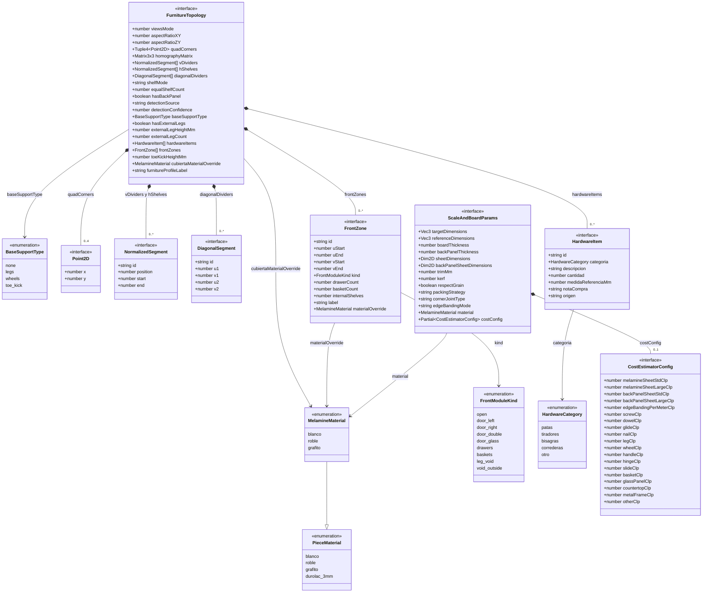
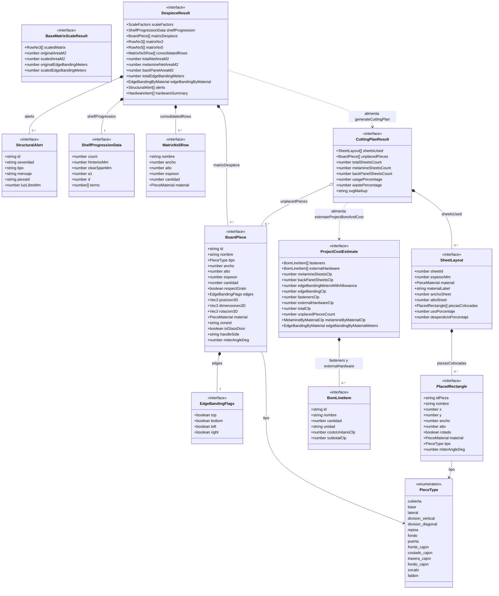

# 02 — Diagrama de Clases e Interfaces de Dominio (SmartFurniture v8.0)

> Modelado completo del 100 % de los contratos en [`src/types/contracts.ts`](../../src/types/contracts.ts) v8.0 más las interfaces de presupuesto en [`src/core/cuttingStock/costEstimator.ts`](../../src/core/cuttingStock/costEstimator.ts).

## Subsistema A — Topología, Parámetros, Zonas Frontales y Tarifas CLP

## Subsistema B — Despiece Físico 1:1, Alertas, Corte 2D Bicolor y Presupuesto CLP

## Resumen de Metadatos Tipados v8.0 en `BoardPiece` y `PlacedRectangle`

| Campo | Interfaz | Propósito en SmartFurniture v8.0 |
|---|---|---|
| `zoneId?: string` | `BoardPiece` | Vincula cada pieza física a su `FrontZone` origen para resaltado interactivo bidireccional 2D <-> 3D. |
| `isGlassDoor?: boolean` | `BoardPiece` | Identifica puertas vidriadas de forma tipada para render translúcido y marco en `Viewer3D` (cero parsing de strings en IDs). |
| `handleSide?: 'left' \| 'right' \| 'top' \| 'none'` | `BoardPiece` | Ubica tiradores exactos en `Viewer3D` y `VectorBlueprintPanel` sin inferencias frágiles. |
| `miterAngleDeg?: number` | `BoardPiece`, `PlacedRectangle` | Registra el ángulo de corte en inglete (grados) para divisiones diagonales (`division_diagonal`) en despiece y plano de corte SVG. |
| `material?: PieceMaterial` | `SheetLayout`, `PlacedRectangle` | Garantiza separación estricta de planchas por `(espesorMm, material)` en muebles bicolor (`blanco` / `roble` / `grafito` / `durolac_3mm`). |
| `tipo?: PieceType` | `PlacedRectangle` | Colorea por categoría funcional los rectángulos del plano de corte SVG (`svgGenerator.ts`). |
