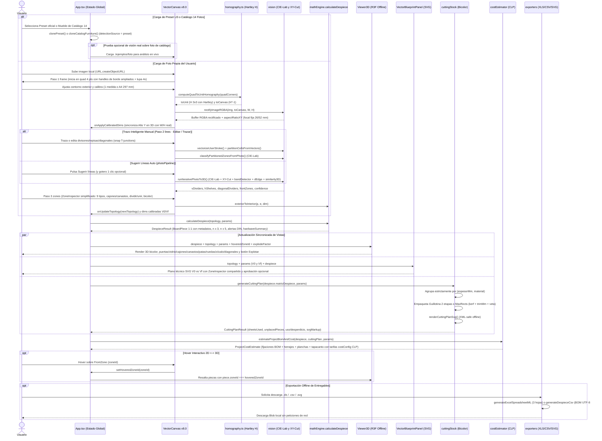

# 03 — Diagrama de Secuencia End-to-End (SmartFurniture v8.0)

> Traza el ciclo completo de datos desde la entrada (foto real del usuario, catálogo QA de 14 fotos o preset oficial Unidad 3) hasta la reconstrucción 3D sincronizada, el plano técnico vectorial, el corte 2D bicolor, el presupuesto editable en CLP y la exportación 100 % offline.

## Puntos Críticos de Integración

1. **Conversión de Espacio:** Las coordenadas que salen de `homography.ts` y `vision` están en espacio **exterior** `[0, 1]^2` del contorno del mueble. Antes de persistir `NormalizedSegment` en `FurnitureTopology`, siempre se transforman al espacio **interior** con `exteriorToInterior(p, e, dim)`.
2. **Separación Estricta de Planchas Bicolor:** `cuttingStock.generateCuttingPlan` particiona `matrizDespiece` por clave compuesta `(espesorMm, material)` para impedir que piezas de melamina `blanco`, `roble`, `grafito` o `durolac_3mm` compartan la misma plancha.
3. **Presupuesto Reactivo y Cuadrado:** `MathPanel` memoiza `estimateProjectBomAndCost` y propaga cualquier tarifa unitaria editada por el usuario mediante `params.costConfig`, reflejándose tanto en pantalla como en la Hoja 2 y Hoja 3 del archivo Excel `.xls`.
