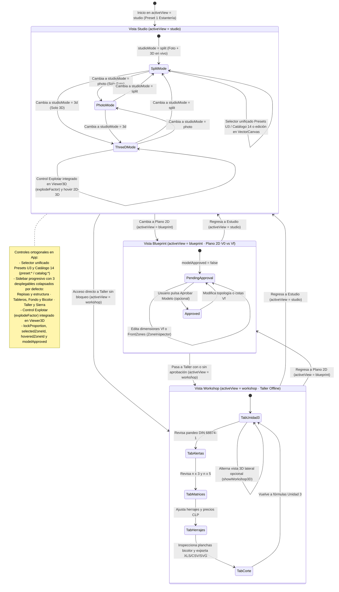
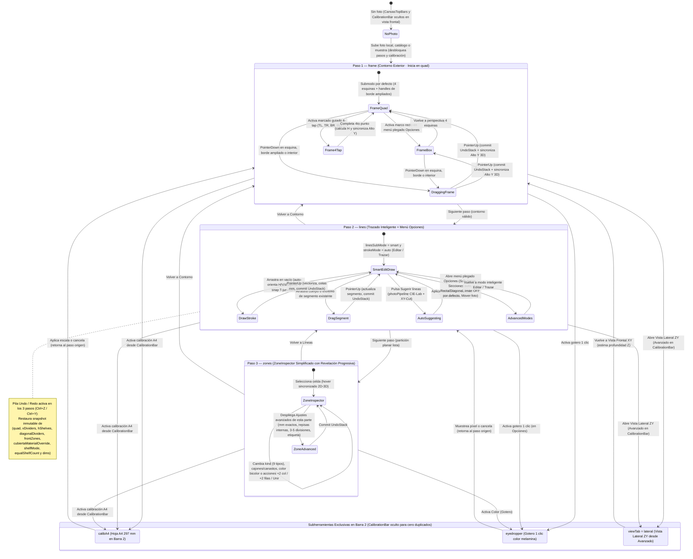

# 04 — Diagramas de Máquinas de Estados (SmartFurniture v8.0)

> Especificación formal de estados para el orquestador global (`App.tsx`) y el editor interactivo de fotografía (`VectorCanvas` v8.0), reflejando la UX simplificada con revelación progresiva, cero secuestros de herramientas y cero duplicación de controles.

## Máquina de Estados A — Navegación, Modos de Estudio y Aprobación de `App.tsx`

## Máquina de Estados B — `VectorCanvas` v8.0 (3 Pasos Simplificados + Subherramientas sin Duplicados + Undo/Redo)

## Invariantes de Interacción v8.0

1. **Lienzo Limpio sin Foto:** Cuando `!hasPhoto` en vista frontal, `CanvasTopBars` y `CalibrationBar` no se renderizan, evitando mostrar controles inactivos antes de cargar una imagen.
2. **Sincronización Automática de Proporción en Paso 1 (`frame`):** El editor inicia en `frameMode = 'quad'` con handles de borde ampliados; al confirmar o arrastrar el contorno exterior, `commitOuterFrame` recalcula la relación `W/H` y sincroniza automáticamente `Alto Y` del modelo 3D.
3. **Revelación Progresiva y Cero Duplicación:** En Paso 2 (`lines`) el modo inteligente `Editar / Trazar` (`smart` + `auto`) cubre el flujo principal y agrupa opciones secundarias (`Solo trazar`, `Secciones auto`, `Recta`/`Diagonal`, `Imán` en OFF por defecto) bajo el menú plegado `Opciones`. Cuando `calibA4` o `viewTab = 'lateral'` están activos, `CalibrationBar` se oculta y sus acciones exclusivas viven únicamente en Barra 2, retornando al paso origen al completar o cancelar.
4. **Historial Unificado (`Undo/Redo`):** Toda mutación confirmada guarda un snapshot inmutable completo que incluye también `dims` y `cubiertaMaterialOverride`, restaurando geometría, acabado bicolor y dimensiones calibradas al deshacer o rehacer.
