# 05 — Diagrama de Actividad del Flujo UX Dual (SmartFurniture v8.0)

> Describe las dos entradas complementarias de **SmartFurniture v8.0** —la ruta académica/QA instantánea mediante selector unificado (Rama A) y la ruta simplificada de digitalización desde fotografía propia (Rama B)— y su convergencia hacia la parametrización progresiva, la validación 2D/3D y el acceso directo a Taller 100 % offline.

```mermaid
flowchart TD
    START(["Inicio en navegador o PWA Offline"]) --> CHOICE{"Origen del mueble"}

    subgraph RAMA_A["Rama A — Selector Unificado: Presets Unidad 3 y Catálogo QA (14 Fotos)"]
        A1["Elegir en selector unificado: Preset Oficial (Estantería, Rack TV, Clóset) o Mueble del Catálogo 14"]
        A2["Cargar topología verificada (detectionSource = preset)"]
        A3{"Desea probar motor de visión real sobre la foto del catálogo?"}
        A4["Abrir foto en VectorCanvas y ejecutar Sugerir líneas o trazado real"]
        A1 --> A2 --> A3
        A3 -- "Sí (Benchmark / Demo)" --> A4
    end

    subgraph RAMA_B["Rama B — Foto Propia del Usuario (UX Simplificada)"]
        B1["Subir foto local sin barras distractoras previas (Protocolo: centrada, >= 3 m, zoom 1x-2x)"]
        B2["Paso 1 frame: Inicia en modo quad 4 esquinas con handles de borde ampliados y lupa 4x (marco recto e imán Sobel opcionales en Opciones)"]
        B3["Calcular homografía H 3x3 (Hartley), rectificar imagen RGBA y sincronizar automáticamente Alto Y en 3D"]
        B4["Calibrar escala real: confirmar 1 medida conocida o activar Hoja A4 297 mm sin controles duplicados (Vista Lateral ZY y Lente en Avanzado)"]
        B5["Paso 2 lines: Modo inteligente Editar / Trazar (auto-orienta H/V/diagonal con snap) o Sugerir líneas (photoPipeline CIE-Lab + XY-Cut); modos avanzados e imán Sobel en Opciones"]
        B6{"Confianza de detección >= 0.50?"}
        B7["Ajuste fino opcional arrastrando segmentos/extremos con Undo/Redo completo (incluye dims y bicolor)"]
        B8["Aviso explícito de baja confianza: completar líneas en modo Editar / Trazar"]
        B9["Paso 3 zones: ZoneInspector simplificado (9 tipos, cajones/canastos, color bicolor, +2 col / +2 filas / Unir; ajustes avanzados plegados)"]
        B1 --> B2 --> B3 --> B4 --> B5 --> B6
        B6 -- "Sí" --> B7 --> B9
        B6 -- "No" --> B8 --> B9
    end

    CHOICE -- "Rama A: Demo rápida / Unidad 3 / QA" --> A1
    CHOICE -- "Rama B: Foto real propia" --> B1

    A3 -- "No (Ir directo a parametrización)" --> CONV
    A4 --> CONV
    B9 --> CONV

    subgraph CONVERGENCIA["Fase Común — Parametrización Progresiva, Validación y Acceso Directo a Taller"]
        CONV["Ajustar medidas Vf (mm/cm) y material en sidebar progresivo (3 desplegables colapsados: Repisas/estructura, Tableros/Fondo/Bicolor, Taller/Sierra)"]
        REV["Revisar en vivo: Visor 3D interactivo (hover 2D-3D, botón Explotar integrado) y/o Plano Vectorial 2D (V0 vs Vf)"]
        ALERT{"Alerta estructural DIN 68874-1 o pandeo > 850 mm?"}
        FIX["Agregar divisor vertical o ajustar vano en vivo hasta 0 alertas"]
        BLUEPRINT_OPT["Opcional: revisar Plano 2D V0 vs Vf y marcar Aprobar Modelo (modelApproved = true)"]
        WORKSHOP["Acceso directo a Taller (sin compuerta bloqueante): Unidad 3, Alertas DIN, Matrices n x 3 / n x 5, Corte 2D Bicolor y Presupuesto CLP editable"]
        EXPORT["Exportar 100 % offline: Excel .xls (3 hojas), CSV Chile (; + BOM UTF-8) y Planos SVG"]

        CONV --> REV --> ALERT
        ALERT -- "Sí" --> FIX --> REV
        ALERT -- "No (Directo a Taller)" --> WORKSHOP
        ALERT -- "No (Revisar Plano 2D)" --> BLUEPRINT_OPT --> WORKSHOP
        WORKSHOP --> EXPORT
    end

    EXPORT --> ENDNODE(["Fin: Proyecto listo para corte en taller y entrega INACAP"])
```

## Claves de Usabilidad del Flujo Dual

- **Transparencia en Rama A:** Los 3 presets oficiales Unidad 3 y los 14 muebles del catálogo QA se eligen desde un selector unificado (`preset:*` / `catalog:*`) con `detectionSource: 'preset'`, permitiendo probar el motor de visión real (`photoPipeline`) sobre cualquier foto del catálogo en 1 clic.
- **Ruta Fluida y Sin Fricción en Rama B:** Antes de subir foto el lienzo se mantiene limpio sin barras de pasos; al ajustar el contorno `quad` con handles ampliados, la proporción `Alto Y` del modelo 3D se sincroniza automáticamente; en Paso 2 el modo inteligente `Editar / Trazar` deja el imán Sobel y modos expertos bajo el desplegable `Opciones`, y el historial `Undo/Redo` cubre también `dims` y `cubiertaMaterialOverride`.
- **Acceso Directo a Taller + Revelación Progresiva:** El usuario puede pasar a Taller en cualquier momento sin bloqueo obligatorio por aprobación previa, con los parámetros secundarios del sidebar plegados en 3 secciones colapsables y el control `Explotar` integrado directamente en `Viewer3D`.
- **Aislamiento de Costos y Herrajes:** Tanto en Rama A como en Rama B, patas, ruedas, tiradores, bisagras, correderas y canastos se gestionan en `hardwareSummary` y en el estimador CLP sin alterar nunca las cotas de melamina ni contaminar las planchas de corte.
