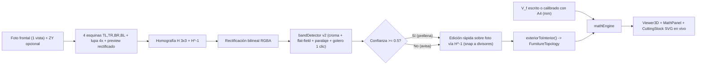

# SmartFurniture: Análisis Técnico Pre-Implementación v2.1 (Rev. 2)

> **Estado:** análisis cerrado y **100 % sincronizado** con `pauta.md`, `Auditoria y Prompts.txt`, `.agents/skills/` y `docs/evidencia/`. Aún no existe código de producción (`src/`); listo para iniciar el **Bloque 1**.
> **Fecha:** 20 nov 2026 · **Entrega:** 1 dic 2026 · **Asignatura:** Funciones y Matrices, Unidad 3 (INACAP)
> **Cambios en Rev. 2 (20 nov):**
> 1. Sincronización total de todos los documentos y prompts del repositorio (cero contradicciones v2.0 vs v2.1).
> 2. Mejora del detector de visión (`bandDetector.ts`) con **croma + luminancia**, **sembrado en 4 bordes** (tolerante a jitter de clic), **anclaje unilateral consciente de paralaje** y soporte de **gotero de 1 clic** (`8/8` escenarios en `band_test.ts`, error `≤ 1,2 mm`).
> 3. Corrección del optimizador guillotina (`guillotine_sim.ts`) para evaluar **rotación real 90°** cuando `respectGrain = false`, coordenadas `(x, y)` verificadas sin solapamiento y demostración real de reducción de planchas (`2 → 1`).
> 4. Mantenimiento de cumplimiento **100 % con `pauta.md`** (incluyendo Vista Lateral ZY como pestaña opcional limpia) y adelanto del núcleo `src/core/vision/` a los días **23–24 nov**.

---

## 1. Resumen ejecutivo

1. **Bloques 1–3 (matemática, corte, 3D) son deterministas y de riesgo bajo.** El cuello de botella real está en lograr un flujo **Foto → 3D confiable en fotos reales** y en el **calendario** (8–9 días de código antes de grabar el 29–30 nov).
2. **Replanteamiento central de Foto → 3D:** el usuario define o ajusta `V_f` en mm. De la foto se necesita **topología exacta** (divisores y repisas normalizados). La homografía de 4 esquinas entrega esa topología **sin depender de la relación de aspecto**. La proporción `W/H` (focal fija) y la calibración A4 solo prellenan `V₀`/`V_f`.
3. **Seis mejoras respaldadas por evidencia reproducible:**

| # | Mejora | Evidencia reproducible |
|---|---|---|
| C1 | **Zhang con focal fija** (`26 mm` eq. o selector 1×/2×, sin parser EXIF innecesario) | [`zhang_sim.ts`](./evidencia/zhang_sim.ts): en clóset típico inclinado, Zhang con `f` estimada falla en `43 %` (p95 `21,3 %`); con focal fija p95 = **`2,0 %`** (`2,9 %` incluso con error de `15 %` en focal) |
| C2 | **Detector de bandas croma + luminancia + paralaje unilateral + 4 bordes + gotero 1 clic** | [`bandDetector.ts`](./evidencia/bandDetector.ts) + [`band_test.ts`](./evidencia/band_test.ts): **`8/8` escenarios** aprobados (incluyendo paralaje `~100 mm` en clóset de `550 mm` a 3 m, jitter de `3 px` en esquina y roble con misma luminancia que el hueco), error máx. **`1,2 mm`**, tiempo `14–111 ms` en Android; blanco sobre blanco marcado **NO CONFIABLE** |
| C3 | **Guillotina 2 etapas con rotación real sin veta** (+ opción `'maxrects'`) | [`guillotine_sim.ts`](./evidencia/guillotine_sim.ts): pasa 4 casos límite de kerf + verificación de cero solapamiento y límites. En módulo `900×1150×410`, alternar `respectGrain` reduce de **2 → 1 plancha** (`33,7 % → 67,4 %`, 5 piezas rotadas). Planchas Chile (`2500×1830`, `2440×1520`) soportadas como selector |
| C4 | **Contratos v2.1 Rev. 2 congelables sin ambigüedades** | Espacio interior normativo + `exteriorToInterior` (evita error de `9 mm`), convención explícita de `v = centro` en repisas `custom`, `1/3` y `2/3` exactos en Preset 2 (`503,33 mm`), descuento `-e/2` en extremos sobre divisor, y división de fondo si **un** lado excede el largo de plancha |
| C5 | **Toolchain fijado y verificado offline** | [`toolchain-spike/`](./evidencia/toolchain-spike/): React `18.3.1`, `three 0.162.0`, R3F `8.18.0`, drei `9.122.0`, Vite `6.3.5`, Vitest `3.2.4`, TS `~5.8.3` → `vitest` ✅, `tsc -b` ✅, `vite build` ✅, cero peticiones de red |
| C6 | **Cumplimiento 100 % de `pauta.md` + adelanto de `src/core/vision/`** | Se conservan los 4 pasos, 3 presets, calibración A4 perspectiva-invariante y Vista Lateral ZY (pestaña opcional), pero `src/core/vision/` se implementa y calibra con fotos reales los días **23–24 nov** |

---

## 2. Arquitectura del flujo Foto → Análisis → 3D



- **Regla de producto:** la detección automática es un **asistente de alta precisión** pensado para ahorrar trazado manual, y la edición manual asistida (lupa 4×, vista rectificada en vivo, gotero de color de 1 clic, agregar/arrastrar/borrar líneas con imán) es la **ruta 100 % garantizada**.
- **Conexión directa con Unidad 3 (defensa en video):**
  - Homografía `H` y `H⁻¹`: **álgebra matricial `3×3`** y sistema lineal `8×8` (eliminación gaussiana con pivoteo parcial).
  - Perfiles de cobertura por fila/columna: **sumatorias discretas**.
  - Filtro de banda con flanco adyacente: **convolución 1D / producto punto**.
  - Conversión `exteriorToInterior`: **función afín invertible**.

---

## 3. Evidencia experimental reproducible

Ejecutar con Node ≥ 24 (`node --no-warnings <archivo>.ts`) o Node 22 con `--experimental-strip-types`.

### 3.1 Estabilidad de la proporción W/H con 4 clics: [`zhang_sim.ts`](./evidencia/zhang_sim.ts)

Mueble de `1500×2100`, lente equivalente `26 mm`, pantalla `1000×750`, ruido de clic `σ = 2,5 px`, 4000 repeticiones por escenario. Error absoluto (mediana / p95):

| Escenario | Euclidiano | Zhang (`f` estimada) | **Focal fija 26 mm** | Focal fija errada en 15 % |
|---|---|---|---|---|
| Frontal (3°, 3°) | 0,57 / 1,6 % | 0,62 / 1,9 % · `f²` inválida 37 % | **0,57 / 1,6 %** | 0,57 / 1,7 % |
| **Clóset típico, celular inclinado (15°, 0°)** | 3,3 / 4,7 % | 3,2 / **21,3 %** · `f²` inválida **43 %** | **0,69 / 2,0 %** | 1,15 / 2,9 % |
| Desde un costado (12°, 20°) | 3,6 / 5,0 % | 0,91 / 2,7 % | **0,80 / 2,3 %** | 1,26 / 3,5 % |
| Muy oblicua (20°, 35°) | 13,0 / 14,3 % | 1,36 / 3,9 % | **1,08 / 3,1 %** | 3,8 / 6,9 % |

**Decisión de alcance:** como la focal fija `26 mm` (con selector manual 1× / 2× si el usuario usó teleobjetivo) da p95 `≤ 2,9 %` incluso con `15 %` de error —y solo sirve para prellenar `V₀`—, **se omite escribir un parser binario de EXIF offline**.

### 3.2 Detector de estructura (Rev. 2): [`bandDetector.ts`](./evidencia/bandDetector.ts) + [`band_test.ts`](./evidencia/band_test.ts)

Pruebas en espacio rectificado con libros/ropa aleatorios, sombras bajo repisas, gradiente lateral fuerte, ruido de sensor, **paralaje 3D real (`550 mm` a 3 m)**, **error de clic de 3 px** y **melamina roble con luminancia igual al hueco** (ejecutado en Android/Termux):

| # | Escenario | Resultado | Error máx. | `interiorMatch` / Confianza | Tiempo |
|---|---|---|---|---|---|
| 1 | Estantería `800×1800`, 4 repisas, libros | ✅ 4/4 | 1,0 mm | 28 % · Confiable (74 %) | 89 ms |
| 2 | Rack TV `1600×550`, vano mixto, objetos | ✅ 2 div + 1 rep | 0,0 mm | 25 % · Confiable (77 %) | 14 ms |
| 3 | Clóset `1500×2100`, 3 izq + 1 der, ropa | ✅ 1 div + 4 rep | 0,5 mm | 30 % · Confiable (73 %) | 30 ms |
| 4 | Grafito oscuro `800×1800` | ✅ 3/3 | 1,2 mm | 26 % · Confiable (77 %) | 29 ms |
| 5 | **Paralaje real:** Clóset `1500×2100×550` a 3 m (caras visibles `~100 mm`) | ✅ **1 div + 4 rep** | **0,5 mm** | 37 % · Confiable (67 %) | 60 ms |
| 6 | **Jitter de clic (3 px borde izq)** + paralaje Estantería `320 mm` | ✅ **4/4** | **1,0 mm** | 37 % · Confiable (67 %) | 30 ms |
| 7 | **Roble vs hueco misma luminancia** (canal croma RGBA) | ✅ **4/4** | **1,0 mm** | 9 % · Confiable (92 %) | 111 ms |
| 8 | **Estrés:** blanco sobre blanco (`204` vs `224`) | ✅ **Marcado NO CONFIABLE** | — | 95 % · `< 0,5` → trazado manual | 43 ms |

**Resultado total:** **`8/8` escenarios correctos**.

**Cómo funciona el anclaje de paralaje (sin sesgo):**
- Para una repisa bajo el horizonte óptico (`v < horizonV`), la proyección perspectiva expone su cara superior **arriba** del canto frontal (`row < row_front`), mientras inmediatamente **abajo** está el hueco/sombra. Evaluar `mean(i, i+t) - mean(i+t, i+t+fw)` con flanco adyacente sin brecha produce un **máximo estricto único en el canto frontal exacto** (`0 px` de sesgo), sin disparar en el borde trasero de la repisa.
- Para una repisa sobre el horizonte (`v > horizonV`), ocurre la simetría exacta en el borde superior del canto frontal. Lo mismo aplica horizontalmente para divisores a izquierda/derecha del centro.
- El muestreo sobre los **4 bordes exteriores de la carcasa** (izquierdo, derecho, superior e inferior) con mediana + MAD resiste errores de clic en una esquina, y se complementa con `seedPoint` (gotero de 1 clic en la UI).

### 3.3 Corte guillotina 2 etapas con rotación real: [`guillotine_sim.ts`](./evidencia/guillotine_sim.ts)

Validación automática de invariantes en cada ejecución: cero solapamientos, separación `≥ kerf`, cotas dentro de `[trimMm, W - trimMm] × [trimMm, H - trimMm]` y casos límite de kerf (`2440×1220` cabe ✅ · `2×1218` en 1 franja ✅ · `2×1220` en 2 franjas ✅ · `2600×1500` en `unplacedPieces` ✅):

| Caso / Preset | Plancha pauta `2440×1220` | Plancha Chile (`2500×1830` / `2440×1520`) |
|---|---|---|
| Estantería `800×1800×320` (18 mm, veta ON) | 2 planchas, `44,0 %` (óptimo con veta) | **1 plancha**, `57,2 %` |
| Rack TV `1600×550×400` (18 mm, veta ON) | 1 plancha, `77,4 %` | 1 plancha, `50,4 %` |
| Clóset `1500×2100×550` (18 mm, veta ON) | 3 planchas (cota inf. 3), `74,4 %` | 2 planchas (cota inf. 2), `72,6 %` |
| Clóset fondo `2×750×2100` (3 mm, sin veta) | 2 planchas, `52,9 %` | **1 plancha** Durolac, `84,9 %` |
| **Demo cambio de veta (`900×1150×410`, 1 repisa)** | **`respectGrain=true`: 2 planchas (`33,7 %`, 0 rot.) → `false`: 1 plancha (`67,4 %`, 5 rot.)** | — |

> **Hallazgo resuelto en Rev. 2:** la versión anterior de `guillotine_sim.ts` nunca rotaba piezas con `ancho > alto` al desactivar `respectGrain`, dejando inmóvil el plano SVG durante la demo. Ahora evalúa políticas de orientación `(default, preferRotated, mixed)` cuando `!respectGrain`, garantizando mejora real sin romper la cortabilidad en seccionadora guillotina.

### 3.4 Prueba del toolchain offline: [`toolchain-spike/`](./evidencia/toolchain-spike/)

- Escena R3F con `<Edges>`, `<Line>`, `<Html>`, `CanvasTexture` y `OrbitControls`.
- `vitest run` ✅ · `tsc -b` (strict) ✅ · `vite build` ✅ (`11 s`, bundle `998 kB` / `277 kB` gzip).
- Cero peticiones de red en tiempo de ejecución.

### 3.5 Limitaciones honestas (qué falta validar)

- Las pruebas `8/8` de `band_test.ts` incluyen paralaje, ruido, gradiente, error de clic y croma, **pero siguen siendo imágenes sintéticas** (sin reflejos especulares reales, compresión JPEG ni lentes reales).
- La validación con **8–12 fotos reales de celular** sigue siendo la tarea de mayor impacto y se ejecuta en los días **23–24 nov**.

---

## 4. Modos de falla en fotos reales de celular y mitigaciones

| # | Modo de falla | Estado | Mitigación implementada / prevista |
|---|---|---|---|
| 1 | **Paralaje** (cara superior/inferior visible 2–8× más gruesa que 18 mm) | 🟡 Resuelto en sintético; calibrar en reales | Anclaje unilateral sin brecha en `bandDetector.ts` + protocolo de foto a `≥ 3 m` y media altura |
| 2 | **Carcasa blanca + fondo blanco** | 🔴 Límite físico | Confianza `< 0,5` (`interiorMatch > 0,5`) avisa al usuario y activa trazado manual rápido (opcional: evaluar perfil de sombra inferior en reales) |
| 3 | **Error humano al marcar 4 esquinas** | 🟢 Mitigado | Lupa 4× + vista rectificada en vivo + muestreo en los 4 bordes + gotero de 1 clic |
| 4 | **Madera/roble con brillo similar a sombra** | 🟢 Mitigado | Modelo combinado luminancia *flat-field* + crominancia normalizada RGBA |
| 5 | **Gran angular `0,5×` (distorsión de barril)** | 🟠 Protocolo | Exigir `1×–2×` en el protocolo visible dentro de la UI |
| 6 | **Puertas o cajones cerrados** | 🟠 Alcance | Alcance explícito: mueble abierto, sin puertas |
| 7 | **Libros, ropa y objetos dentro** | 🟢 Probado | Perfiles de cobertura + regla estructural (divisores continuos de cubierta a base) |
| 8 | **WhatsApp comprime / recorta** | 🟡 Protocolo | Enviar como **Documento** y nunca recortar |

---

## 5. Contratos definitivos v2.1 (Rev. 2) — congelar en Bloque 1

Todos los campos nuevos sobre v2.0 son **opcionales** con valores por defecto seguros:

```ts
// src/types/contracts.ts — Convenciones normativas v2.1 (Rev. 2)

/**
 * ESPACIO DE COORDENADAS (normativo):
 * - NormalizedSegment vive SIEMPRE en espacio INTERIOR [0, 1]^2:
 *     u = 0 -> cara interna lateral izquierdo (x = e); u = 1 -> cara interna derecho (x = x_f - e)
 *     v = 0 -> cara superior de la base (y = e);       v = 1 -> cara inferior cubierta (y = y_f - e)
 * - En modo 'custom', hShelves[i].position es el CENTRO vertical de la repisa (cy = e + v * y_int);
 *   validar/restringir que la repisa quede dentro de [e + e/2, y_f - e - e/2] para evitar solapamiento.
 * - En modo 'equidistant', ShelfProgressionData.terms[k] es la CARA INFERIOR a_n -> cy = a_n + e/2.
 * - La homografía de foto produce espacio EXTERIOR -> convertir con exteriorToInterior().
 */

export interface FurnitureTopology {
  // ...campos base v2.0...
  detectionSource?: 'manual' | 'auto' | 'preset';
  /** 0..1. Si < 0.5, la UI muestra advertencia y facilita revisión/trazado manual. */
  detectionConfidence?: number;
}

export interface ScaleAndBoardParams {
  // ...campos base v2.0...
  /** Margen de escuadrado por borde (Sodimac/Imperial: 10-15 mm). Default 0. */
  trimMm?: number;
  /** Default 'guillotine' (cortable en seccionadora). 'maxrects' opcional (CNC). */
  packingStrategy?: 'guillotine' | 'maxrects';
  /** Plancha del fondo de 3 mm (ej. Durolac Chile 2440x1520). Default = sheetDimensions. */
  backPanelSheetDimensions?: { width: number; height: number };
}
```

```ts
// src/core/mathEngine/index.ts — Helpers puros obligatorios
/** Convierte coordenada normalizada exterior [0,1] -> interior [0,1]. */
export const exteriorToInterior = (p: number, e: number, dim: number): number =>
  (p - e / dim) / (1 - (2 * e) / dim);

/** Convierte coordenada normalizada interior [0,1] -> exterior [0,1]. */
export const interiorToExterior = (p: number, e: number, dim: number): number =>
  p * (1 - (2 * e) / dim) + e / dim;
```

**Reglas normativas adicionales congeladas:**
1. **Test obligatorio de coordenadas:** `exteriorToInterior(0.25, 18, 800) ≈ 0.2382` (evita bug de `9 mm`).
2. **Vanos mixtos (cruces Y extremos):** descontar `e/2` también cuando `uStart` o `uEnd` coinciden (`<= 1e-3`) con un `vDivider`.
   - Preset 2 (`rack_tv`): usar **`1 / 3` y `2 / 3` exactos** (no `0.333`/`0.667`) → repisa central = **`503,33 mm`**.
   - Preset 3 (`closet`): repisas izquierda/derecha = **`723 mm`** (`18 + 723 + 18 + 723 + 18 = 1500`).
3. **Subdivisión del fondo 3 mm:** dividir verticalmente si `(x_f > minS && y_f > minS)` **O** `x_f > maxS` **O** `y_f > maxS` (usando `backPanelSheetDimensions ?? sheetDimensions`).

---

## 6. Stack fijado y notas de entorno

```json
{
  "dependencies": {
    "react": "18.3.1",
    "react-dom": "18.3.1",
    "three": "0.162.0",
    "@react-three/fiber": "8.18.0",
    "@react-three/drei": "9.122.0",
    "lucide-react": "^0.454.0"
  },
  "devDependencies": {
    "@types/react": "^18.3.12",
    "@types/react-dom": "^18.3.1",
    "@types/three": "0.162.0",
    "@vitejs/plugin-react": "^4.3.4",
    "typescript": "~5.8.3",
    "vite": "^6.3.5",
    "vitest": "^3.2.4"
  }
}
```

- **No usar `vite@latest` ni `three@latest`** (evita rupturas con R3F v8 / Drei v9).
- **Termux (Android):** si `npm run`/`npx` fallan por falta de `/usr/bin/env`, ejecutar:
  `node node_modules/vitest/vitest.mjs run`, `node node_modules/typescript/bin/tsc -b`, `node node_modules/vite/bin/vite.js build`.
- **Validación en escritorio obligatoria:** antes de grabar, verificar el visor WebGL/3D, `VectorCanvas` y modo **DevTools → Network → Offline** en un navegador de escritorio (Windows/Linux/macOS).
- **Gate offline:** correr el `grep` de URLs externas sobre `src/` e `index.html` (no sobre `dist/`, que incluye namespaces XML de `w3.org` y strings de mensajes de error de React/Three).

---

## 7. Plan de ejecución sincronizado (20 nov → 1 dic)

| Fechas | Pista principal de desarrollo | Pista paralela (equipo / fotos) | Compuerta obligatoria |
|---|---|---|---|
| **20–21 nov** | **Bloque 1:** scaffold desde `toolchain-spike`, `contracts.ts` v2.1 Rev. 2, `homography.ts`, `presets.ts`, `mathEngine` | **Sacar 8–12 fotos reales** (protocolo §7 de `RESUMEN_PARA_EL_EQUIPO.md`) y anotar verdad terreno `(divisores, repisas)` | `vitest` 100 % verde |
| **22 nov** | **Bloque 2:** `cuttingStock` (guillotina 2 etapas con rotación sin veta + opción MaxRects + `trimMm` + `backPanelSheetDimensions`) + SVG offline | Subir fotos reales a carpeta local de validación | `vitest` 100 % verde |
| **23–24 nov** | **Núcleo Visión (`src/core/vision/`):** rectificación bilineal RGBA, focal fija `26 mm`, `bandDetector` v2 + suite Vitest + **tabla de regresión sobre fotos reales** | Revisar errores en fotos reales y congelar umbrales | `vitest` + tabla fotos reales |
| **25–26 nov** | **Bloque 3:** `Viewer3D` offline, `MathPanel`, `App.tsx`, 3 presets, selector planchas Chile, CSV (BOM) + SVG | Prueba funcional en navegador de escritorio Offline | `vitest` + `tsc -b` + `vite build` |
| **27–28 nov** | **Bloque 4:** `VectorCanvas` completo (lupa 4×, preview rectificado, botón Detectar, gotero 1 clic, edición manual con snap, calibración A4, Vista Lateral ZY opcional) integrado en vivo al 3D | Elegir las mejores fotos verificadas para el video | `vitest` + `build` + gate offline |
| **29–30 nov** | Grabación y edición del video (1. Unidad 3 con presets · 2. Demo real Foto → 3D) | Los 4 integrantes | Revisión de rúbrica |
| **1 dic** | **Entrega final INACAP** | — | — |

---

## 8. Preguntas abiertas para revisión por el equipo o IA externa

1. **Fotos reales con luz cálida/reflejos:** al recibir las 8–12 fotos reales, ¿conviene agregar un filtro de continuidad de gradiente horizontal (`∂L/∂y`) solo como apoyo para muebles blancos con sombra sutil bajo las repisas, o mantener la separación limpia hacia trazado manual?
2. **Estrategia de corte en UI:** ¿exponer el selector **Guillotina (taller) vs. MaxRects (CNC)** visible en el panel o dejar Guillotina fija y MaxRects en modo avanzado?
3. **Roles del equipo:** confirmar hoy la asignación de los 4 integrantes en `pauta.md` §8 para activar en paralelo la toma de fotos reales mientras avanza el Bloque 1.
